# YousufOS

A premium, Islamic-focused Smart TV interface for an Ubuntu laptop plugged into the living-room TV, and (from 1.9) for Android TVs and Google TV boxes.
Google TV's simplicity, Apple TV's calm, prayer times and Adhan built in, and the UAE at its heart.
Ubuntu, Docker, SSH, Tailscale, Jellyfin and Home Assistant keep running underneath.

Built with **React + Tailwind** (UI) and **Tauri / Rust** (native layer).

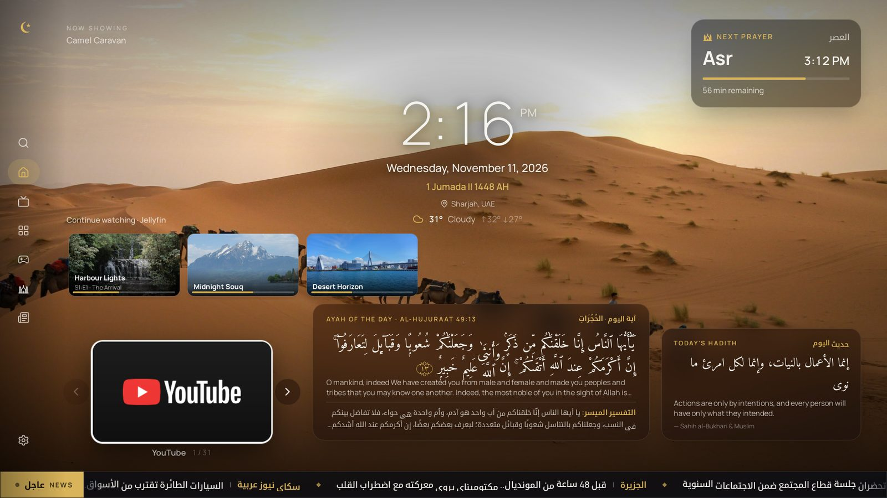

**Download:** the latest `.deb` (Ubuntu), `-setup.exe` (Windows) and `.apk` (Android TV) are on the [Releases](../../releases/latest) page. Android TV: see [docs/android-tv.md](docs/android-tv.md). What changed in each version: [CHANGELOG.md](CHANGELOG.md).

## A quick look

| | |
|---|---|
| 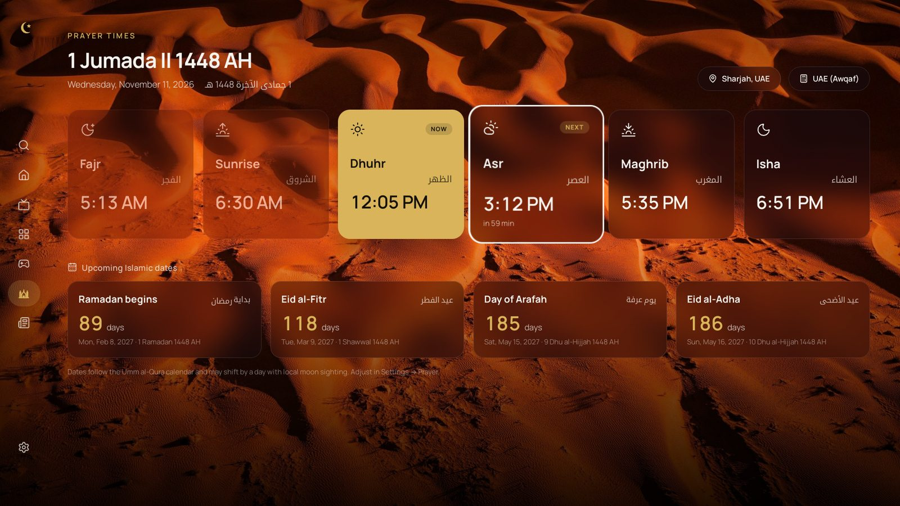 | 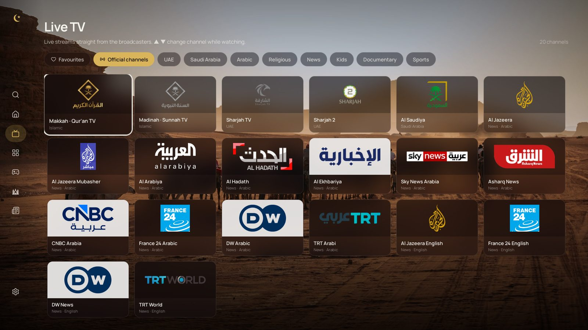 |
| **Prayer.** Today's five prayers with the next one highlighted, and countdowns to Ramadan, Eid and Arafah. | **Live TV.** Official channels straight from the broadcasters, plus free lists by country and category. |
| 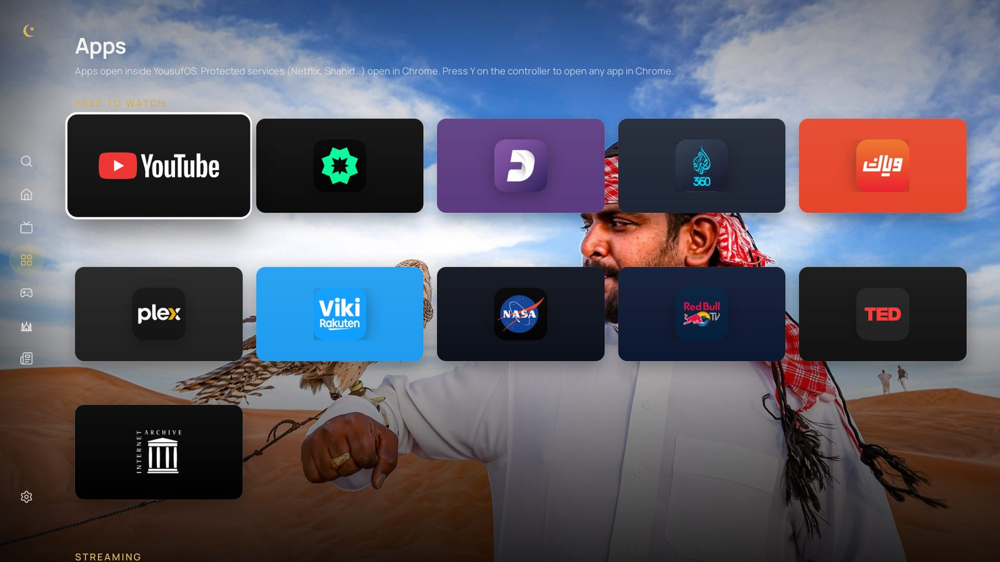 | 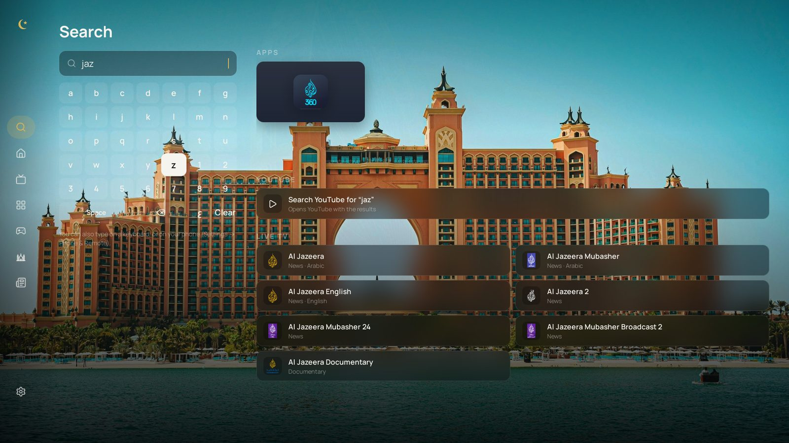 |
| **Apps.** 30 apps that open inside YousufOS and work with a remote or an Xbox controller. | **Search.** One search across apps, YouTube, Jellyfin and Live TV, with an English and Arabic keyboard. |
| 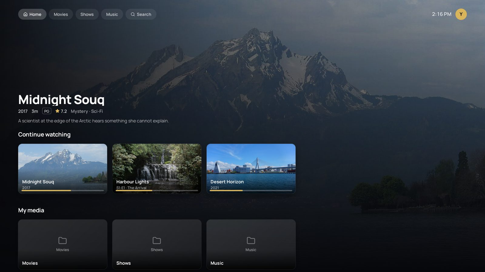 | 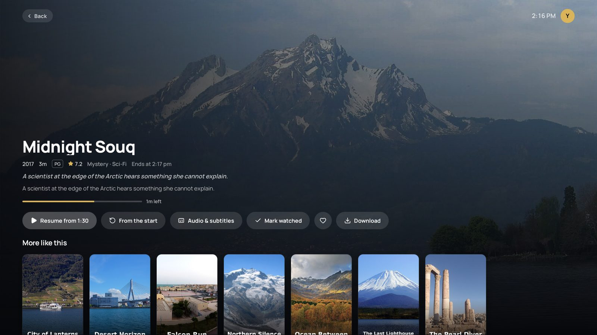 |
| **Jellyfin,** rebuilt for the TV: Continue watching, libraries, and Movies, Shows and Music. *(Shown with a demo library.)* | **Film pages** with resume, audio and subtitles, downloads for offline viewing, and "More like this". |
| 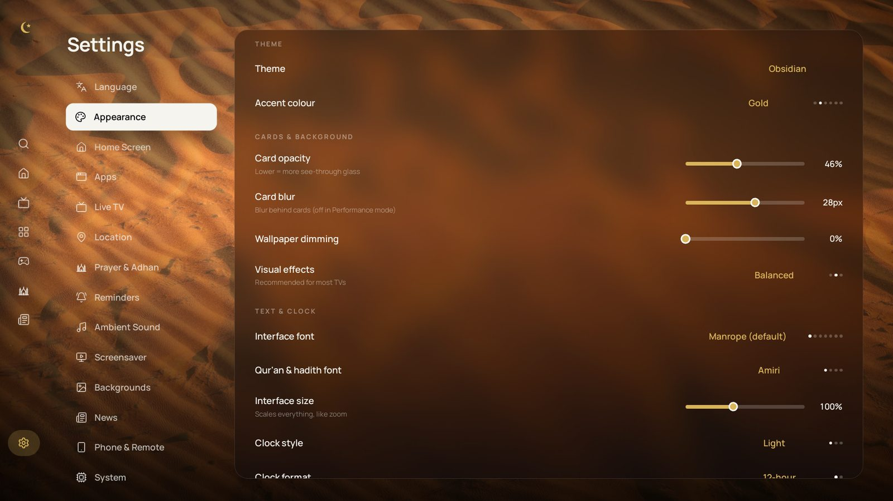 | 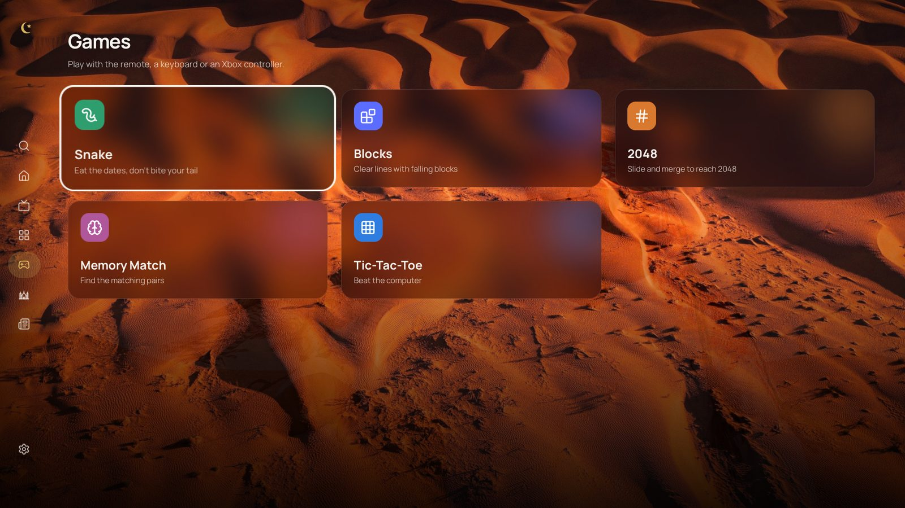 |
| **Settings.** 14 themes, fonts, card glass and blur, 22 languages, and prayer calculation methods. | **Games.** Snake, Blocks, 2048, Memory Match and Tic-Tac-Toe, played with the remote. |

### New in 1.8

| | |
|---|---|
| 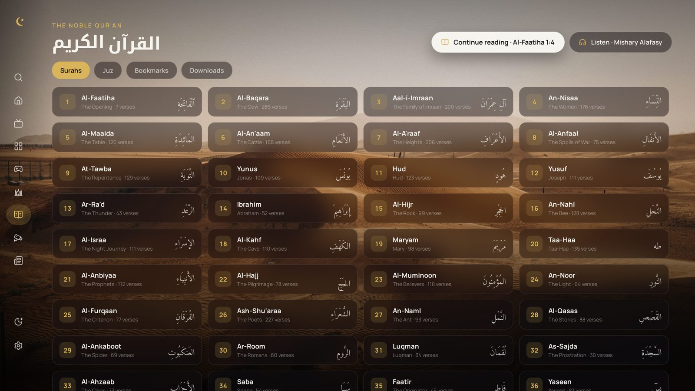 | 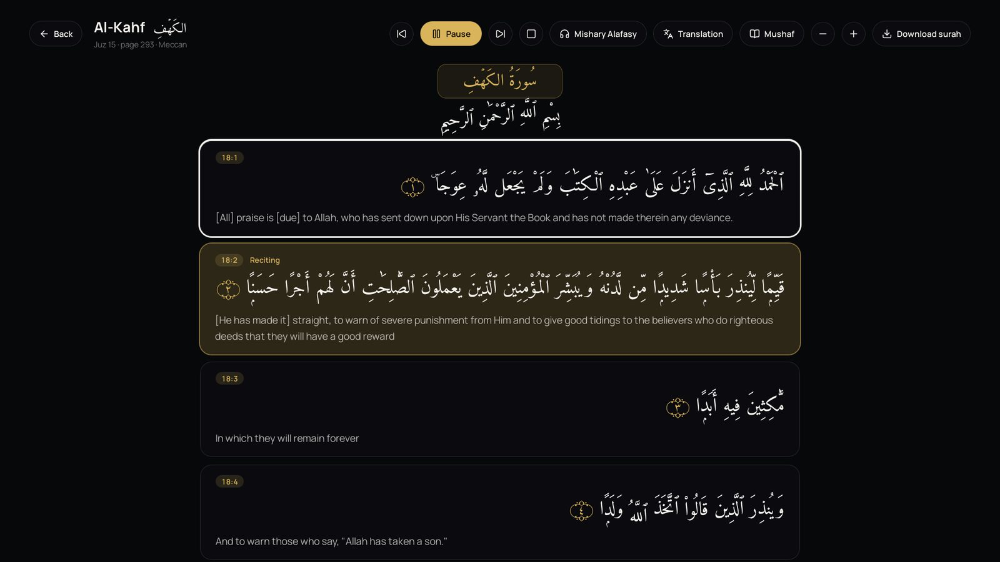 |
| **Qur'an** in the sidebar: surahs, juz, bookmarks and downloads. | **Reading and listening:** the verse being recited is highlighted, with a translation under each verse. |
| 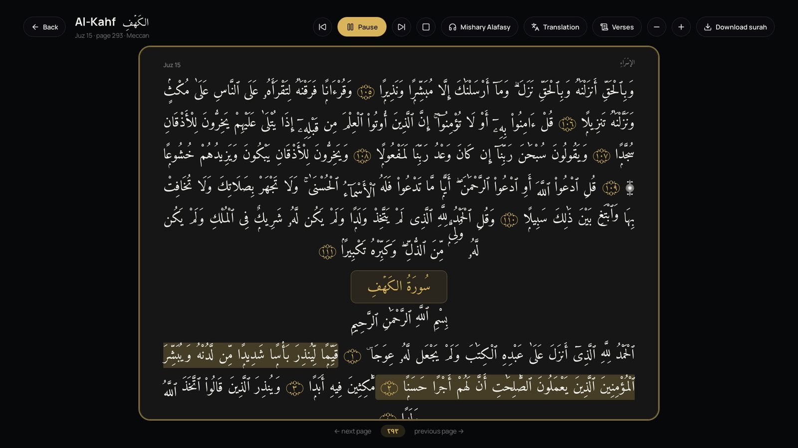 | 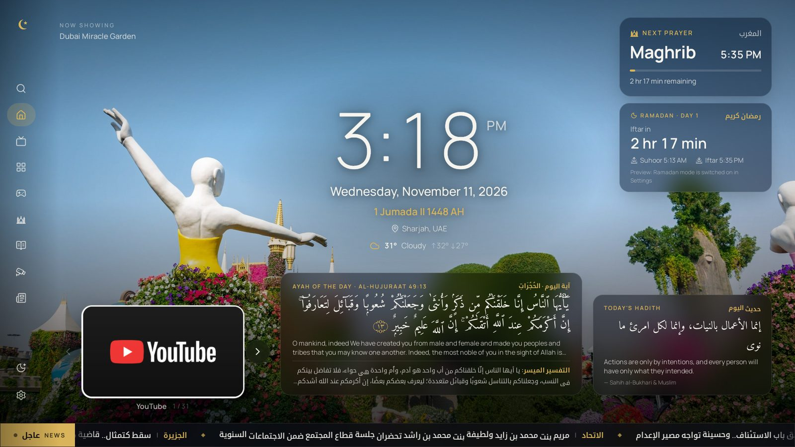 |
| **Mushaf view:** page by page like the printed Madinah mushaf. | **Ramadan mode:** iftar and suhoor countdowns on Home. |
| 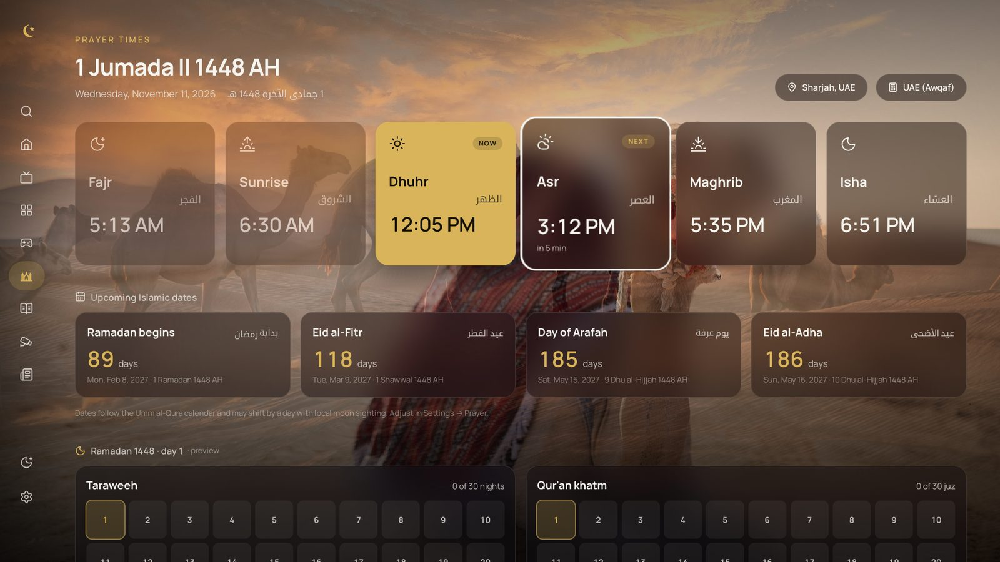 | 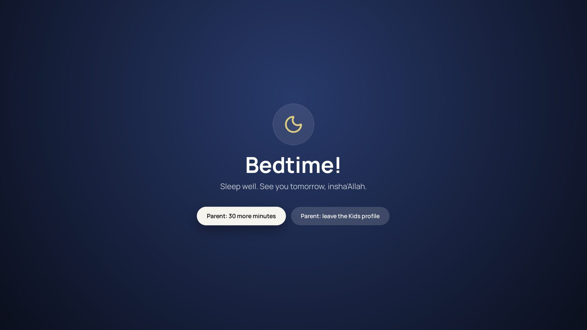 |
| **Taraweeh and khatm trackers** on the Prayer page. | **Kids profile:** a daily limit and a bedtime, with a parent PIN. |

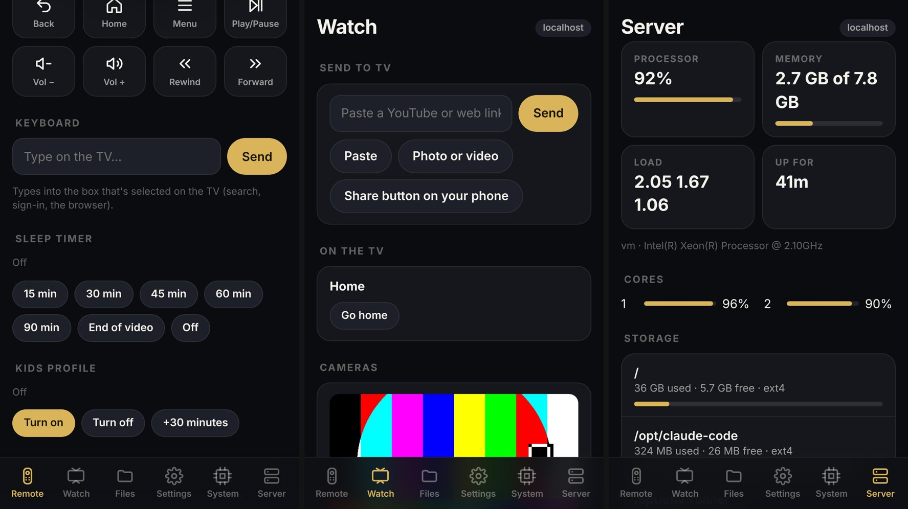

**Phone & Remote.** Control the TV from any phone, tablet or computer on the same Wi-Fi: pair with a PIN, then use the remote, send links and photos, see what's on, and check the system. It installs to the home screen like an app, on iPhone too.

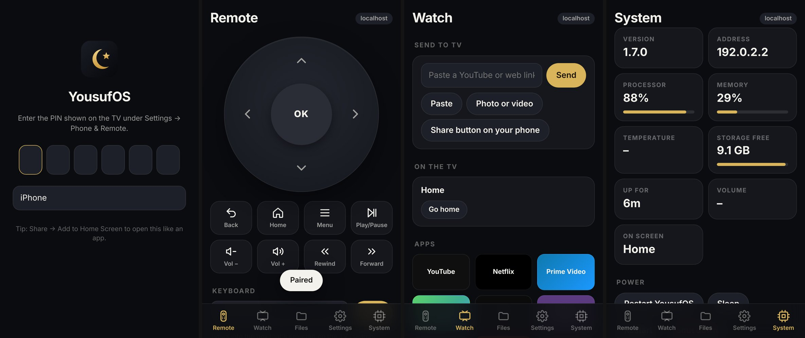

---

## What's in it

| Area | Features |
|---|---|
| **Home** | 42 UAE & Islamic photos up to 4K (smooth two-layer crossfades, day/night matching), large centre clock, Gregorian + Hijri date, location and today's weather, next-prayer widget, Arabic news ticker. Three switches: app cards, the **Ayah of the day** (Arabic, English, Tafsir al-Muyassar) and today's hadith. "Eid Mubarak" on Eid days |
| **Live TV** | **Official channels**: Makkah (Qur'an TV), Madinah (Sunnah TV), Sharjah TV, Al Saudiya, Al Jazeera, Al Arabiya, Al Hadath, Al Ekhbariya, Sky News Arabia, Asharq, CNBC Arabia, France 24, DW, TRT and more, from the broadcasters' own live streams. Plus free channel lists (UAE, Saudi, Arabic, Religious, News, Kids, Documentary, Sports) from iptv-org. Everything plays in YousufOS's own player, with automatic fallback to mpv. ▲▼ change channel, favourites (Y), your own `.m3u` playlists |
| **Browser** | A TV-friendly web browser inside YousufOS: search or type an address, quick links (Quran.com, Sunnah.com, Gulf News, Khaleej Times, Al Khaleej…), Menu for back / forward / reload |
| **On-screen keyboard** | Opens when the controller selects a text box in any app (English and Arabic layouts), and for server addresses in Settings |
| **Games** | Snake, Blocks, 2048, Memory Match, Tic-Tac-Toe; best scores saved |
| **Sidebar** | Collapsed icon rail that expands on focus: Home, Live TV, Apps, Games, Prayer, News, Settings. Up/Down stay in the rail, Right/OK opens the page |
| **Apps** | 30 apps with their real logos. **Free to watch:** YouTube (TV interface), tabii (TRT), Dubai+ (Awaan), Al Jazeera 360, Weyyak, Plex Free Movies, Viki, NASA+, Red Bull TV, TED, Classic Films (Internet Archive). Also Netflix, Prime Video, Shahid, Disney+, OSN+, STARZPLAY, Apple TV, TOD, Twitch, Crunchyroll, YouTube Kids, Spotify, Anghami, YouTube Music, Quran.com, Plex, Jellyfin, Google Photos, Home Assistant. Apps open **inside YousufOS** (no extra windows, cookie pop-ups accepted automatically, links stay on screen); services with protected video open in a full-screen Chrome window |
| **Prayer** | Fajr, Sunrise, Dhuhr, Asr, Maghrib, Isha with the current prayer highlighted and a countdown to the next. Countdowns to Ramadan, Eid al-Fitr, Arafah, Eid al-Adha, Islamic New Year and Ashura |
| **Qur'an** | The whole Qur'an (Uthmani text built in) by surah, juz or mushaf page, translations and tafsir, verse-by-verse recitation from 16 reciters with highlighting, bookmarks, downloads for offline. Ramadan mode with suhoor / iftar countdowns, alarms, Taraweeh and khatm trackers |
| **Cameras** | Live pictures from RTSP / HLS / Home Assistant cameras, full-screen viewing, doorbell pop-up with chime and phone message |
| **Family** | Kids profile (allowed apps and channels, daily limit, bedtime, parent PIN) and a sleep timer |
| **Adhan** | Fullscreen notice at each prayer time, plays the Adhan (Makkah, Madinah, Sheikh Zayed Mosque*, Dubai, Mishary Alafasy or custom; Mishary's Fajr adhan for Fajr), pauses other media, brings the launcher to the front and returns to Home when it finishes |
| **News** | Al Jazeera (breaking), Sky News Arabia (regional), Al Ittihad / Abu Dhabi Media (UAE). Ticker on Home, full headline lists on the News page, refreshed every 10 minutes |
| **Hadith** | 30 short authentic hadith, offline, Arabic + English + source; changes daily |
| **Reminders** | Optional "Astaghfirullah" reminders (every 5 min to 3 hr, quiet at night, optional chime) and Eid takbir with audio during the takbir days |
| **Screensaver** | Clock, Prayer Focus or UAE Photography; 1/5/10/30/60 min or never; OLED drift protection |
| **Ambient sound** | Calm ambient music, gentle rain, ocean waves, desert wind, desert night (all generated live, no files), or Qur'an recitation (Mishary Alafasy / Al-Sudais, streamed) |
| **Languages** | 22 languages: English, العربية (complete, right-to-left), اردو, فارسی, हिन्दी, বাংলা, മലയാളം, தமிழ், Filipino, Indonesia, Melayu, Türkçe, Français, Español, Português, Deutsch, Italiano, Русский, 中文, 日本語, 한국어, Kiswahili |
| **Settings** | 14 themes (Obsidian, Graphite, Abyss, Daylight, Starlit Sky, Liwa Sands, Oasis Palm, Ruby Dusk, Arabian Gulf, Corniche Sunset, Emerald Glow, Old Souq, Desert Rose, Mint Tea), 7 interface fonts + 4 Qur'an/hadith fonts, accent presets / match theme / colour wheel, card opacity, card blur, wallpaper dimming, interface size, clock weight, visual-effects level, 12/24-hour clock, auto or manual location (UAE emirates + Gulf and other cities), UAE (Awqaf) / Umm Al-Qura / MWL / more, Asr method, Hijri ±2-day adjustment, Adhan voice and volume, backgrounds, launch at login, power options |
| **Input** | Keyboard, TV remote, air mouse, mouse, and **Xbox (or any standard) controller** everywhere, including inside apps, with an on-screen pointer and volume on the triggers (see below) |

---

## Install on the TV laptop (Ubuntu 24.04+)

```bash
# 1. One-time system setup: Chrome, playerctl, autostart, no screen blanking
bash scripts/setup-ubuntu.sh

# 2. Install YousufOS (prebuilt package, or build it yourself, see below)
sudo apt install ./YousufOS_1.3.0_amd64.deb
```

Then, in Ubuntu **Settings**:

1. **Users → Automatic Login → On**, so the laptop boots straight into YousufOS.
2. Optional: on the login screen, click the gear and choose **"Ubuntu on Xorg"**. F12 / Ctrl+Alt+Home as global keys need Xorg; everything else (including the controller inside apps) also works on the default Wayland session.
3. **Keyboard → Custom Shortcuts → +**: name `YousufOS Home`, command `yousufos`, then press your remote's **Home** button.
   Pressing it any time closes the current app and returns to the launcher. This also works on Wayland.

Plug the laptop into the TV with HDMI, and set the TV as the only or primary display.

### Xbox controller
| Button | In YousufOS | Inside an app | Live TV (mpv) |
|---|---|---|---|
| D-pad | Move | Arrow keys | ▲▼ channel |
| Left stick | Move | Pointer (arrows in YouTube) | ▲▼ channel |
| A | Select | Click at the pointer / Enter | Channel info |
| B | Back (page → sidebar → Home) | Back (fullscreen → previous page → YousufOS) | Channel list |
| X | Game actions | Play / pause | Pause |
| Y | Open app in Chrome · favourite channel | Fullscreen | Channel info |
| LB / RB | Previous / next page | −10 s / +10 s | Previous / next channel |
| LT / RT | Volume | Volume | Volume |
| Right stick | - | Scroll (pointer in YouTube) | - |
| Menu | Jump to the sidebar | Controller help | - |
| View | Home page | Reload the page | - |
| **Xbox button**, or **View + Menu** | Home | **Back to YousufOS** | Back to YousufOS |

Input goes straight into the app (no fake keyboard), so it works on both Xorg and Wayland. A toast appears when a controller connects.

### Getting back to the launcher from an app
* Your remote's Home button (step 3 above)
* **F12** or **Ctrl+Alt+Home** (Xorg). You can change these with `homeShortcuts` in the config.
* **Alt+F4** closes the app window; YousufOS notices and comes back.

---

## Install on an Android TV (1.9)

YousufOS also runs on TVs with Android TV / Google TV built in and on Android TV boxes, as the TV's home screen.
From a Windows PC on the same Wi-Fi: turn on the TV's developer options, put `YousufOS_<version>_android.apk`
next to `scripts\install-android-tv.ps1` and run the script. The full guide, what works and how to undo it:
[docs/android-tv.md](docs/android-tv.md).

## Develop

```bash
npm install
npm run dev        # UI only, in a normal browser at http://localhost:1420
npm run tv         # full desktop app with hot reload (needs Rust + system deps)
npm run bundle     # build the .deb / AppImage into src-tauri/target/release/bundle/
npx tauri android build --apk --target aarch64 armv7   # the Android TV .apk (needs the Android SDK + NDK)
```

The Android app is the same interface in an Android shell: `src-tauri/gen/android/app/src/main/java/com/nyxel/yousufos/`
has the home-screen activity, the bridge the interface calls (`window.YousufAndroid`: installed apps, the video player,
remote keys, prayer-time alarms, updates), the ExoPlayer video player and the small video window. In the interface,
`isAndroid()` in `src/lib/platform.js` switches the few things that differ.

`npm run dev` works on Windows or anywhere. Everything native has a browser fallback: apps open in a new tab, and settings save to localStorage.
Two exceptions: in a plain browser, the Al Jazeera and Al Ittihad feeds are blocked by CORS (the desktop app fetches them through Rust), and local Adhan files don't play.

Build dependencies on Ubuntu: `bash scripts/setup-ubuntu.sh --dev`.
On Windows, `npm run tv` also works if you have Rust and WebView2; apps then open in Chrome or Edge.

---

## Customising

### Config file
Settings are saved to `~/.config/com.nyxel.yousufos/config.json`. Everything in the Settings page is there, plus a few extras:

```jsonc
{
  "browser": "",                       // "" = auto (google-chrome → chromium → edge)
  "homeShortcuts": ["F12", "Ctrl+Alt+Home"],
  "prayer": { "adjustments": { "fajr": 0, "isha": 2 } },   // minutes, to match a local mosque
  "adhan":  { "customPath": "~/Music/my-adhan.mp3" },
  "backgrounds": { "customDir": "~/Pictures/YousufOS" },
  "news": { "feeds": [ { "name": "الجزيرة", "label": "Breaking", "url": "https://…rss" } ] },
  "apps": null                          // see below
}
```

### Adhan audio
Recordings for every voice are bundled (sources in `CREDITS.md`). To replace one, put an MP3 with the same name in **`~/Music/Adhan/`**
(`makkah.mp3`, `madinah.mp3`, `mishary.mp3`, `dubai.mp3`, `fajr.mp3`, `takbir.mp3`). It takes priority over the bundled file.

\* **Sheikh Zayed Grand Mosque:** no recording with a clear source could be found to bundle. Save one as `~/Music/Adhan/sheikhzayed.mp3`; until then that voice plays the Dubai adhan.
Use **Settings → Prayer & Adhan → Test Adhan** to check.

### Wallpapers
* **Built-in:** 42 photos (sources in `CREDITS.md`). Add more by dropping photos into `src/assets/wallpapers/` named `<collection>-<title>[-night].jpg`,
  e.g. `desert-liwa-dunes.jpg`, `mosques-al-noor-mosque-night.jpg`, `landmarks-jebel-jais.jpg`.
  The title appears on screen. Images with `night` in the name show after Maghrib; the others after sunrise.
  Around 2560px wide is plenty.
* **Without rebuilding:** put photos in `~/Pictures/YousufOS/` and choose **Settings → Backgrounds → Custom Images** (or "All UAE" to mix them in).

Collections: UAE Landmarks (Burj Khalifa, Burj Al Arab, Museum of the Future, Qasr Al Watan, Louvre Abu Dhabi, Ain Dubai, Dubai Marina, Hatta…), Mosques (Sheikh Zayed Grand Mosque inside and out, Sharjah Grand Mosque, the Kaaba…) and Desert (Liwa, Al Ain dunes, camels, a falconer…).

### Apps
To change the app list, set `"apps"` in the config to your own list. Copy the defaults from `src/lib/apps.js`:

```json
"apps": [
  { "id": "youtube", "name": "YouTube", "url": "https://www.youtube.com/tv", "pinned": true, "bg": "#0f0f0f",
    "userAgent": "Mozilla/5.0 (SMART-TV; LINUX; Tizen 6.5) AppleWebKit/537.36 (KHTML, like Gecko) 85.0.4183.93/6.5 TV Safari/537.36" },
  { "id": "jellyfin", "name": "Jellyfin", "url": "http://192.168.1.10:8096", "pinned": true,
    "bg": "linear-gradient(135deg,#aa5cc3,#00a4dc)", "icon": "~/Pictures/jellyfin.png" }
]
```

`pinned` apps appear on Home (up to 6). `icon` is an optional local image; without one, the tile shows the name.

---

## Smoothness on a big TV
* YousufOS forces GPU rendering in the Linux webview. If the screen ever goes black or flickers with your graphics driver, add `"gpu": false` to the config.
  On NVIDIA, starting it with `WEBKIT_DISABLE_DMABUF_RENDERER=1 yousufos` can also help.
* **Settings → Appearance → Visual effects:** *Balanced* (default) keeps blurred cards but still wallpapers; *Performance* removes all blur and is the smoothest; *Full* adds moving wallpapers and blurred pages.
* Lowering **Card blur** helps too: blur is the most expensive effect at 4K.
* Wallpapers are scaled once to your screen's resolution (a 1080p TV doesn't decode 4K photos), pages only redraw when the minute changes, the sidebar previews pages only after you stop on an entry, and the launcher stops drawing while an app is open.

### Live TV
**Official channels** are the broadcasters' own public live streams (the same ones their websites use), played in YousufOS's player.
The other lists come from the public [iptv-org](https://github.com/iptv-org/iptv) project. Many of those streams are limited to their home country or go offline, so some won't play from the UAE.
**Settings → Live TV → Player:** *Automatic* plays in the built-in player and hands over to [mpv](https://mpv.io) when a stream won't play there (mpv handles more formats); *mpv* uses it always.
Add your own playlists in the config:
```json
"iptv": { "playlists": [ { "label": "My channels", "url": "https://example.com/list.m3u" } ] }
```

### Wallpapers from your location
**Settings → Location (or Backgrounds) → Wallpapers from your location.** Every country and territory has its own set of landscape photos of its best-known places: World Heritage Sites, landmarks, national parks and cities, chosen through Wikidata and checked on Wikimedia Commons for size, shape and licence. If your city has enough photos of its own (Paris, Tokyo, Cairo…), you get those; otherwise photos from the whole country. The photographer and licence show under "Now showing". The photos load from Wikimedia when shown, so this needs internet; offline, the built-in UAE photos are used. In the UAE the built-in 4K photos stay in the mix.

**Location** now covers every country and territory (capital and largest cities), with the usual prayer-time method for each country chosen automatically. Press a letter on a keyboard, or use the letter row, to jump through the country list.

Rebuild the catalogues with `scripts/build-world-locations.py`, then `scripts/world-wallpapers-1-places.py`, `scripts/world-wallpapers-1b-territories.py`, `scripts/world-wallpapers-2-photos.py` and `scripts/world-wallpapers-3-fill.py` (usage at the top of each).

### Jellyfin / Home Assistant on another computer
**Settings → Apps → Servers on your network**: type the address of the PC running Jellyfin (e.g. `192.168.1.20`; the port `:8096` is added for you). On that PC, Jellyfin must allow connections from your network (Windows Firewall may ask the first time).

### The YousufOS Jellyfin app (1.6)
The Jellyfin tile opens YousufOS's own Jellyfin app (written for Jellyfin 10.9 and newer, tested against the 12.4 API), drawn in the launcher's style and driven entirely by the remote or controller.
- **Sign in** with **Quick Connect**: the TV shows a 6-digit code; approve it in Jellyfin on your phone (profile → Quick Connect). Or pick a user and type the password with the on-screen keyboard.
- **Home**: Continue watching, Next up, your libraries and what was recently added in each. **Tabs** for every library your server has (Movies, Shows, Music…): a new kind of library shows up as a tab by itself. LB / RB switch tabs.
- **Libraries**: sort A–Z / recently added / year / rating, show unwatched or favourites, shuffle.
- **Films and episodes play in mpv** (any format, nothing converted on the PC): Left / Right −10 / +10 s, A pause or **skip the intro** when the server marks one, X pause, Y subtitles, Menu audio track, LB / RB previous / next episode, B stop. The next episodes play on by themselves. Where you stopped, what's watched and Next up are saved on the server, so the phone and the TV stay in step.
- **Audio & subtitles** button on a film picks tracks before playing. **Y on a poster** marks it watched.
- **Music** plays inside the launcher with a small now-playing bar.
- Settings → Apps: turn the app off to use Jellyfin's own web page instead (Y on the tile always opens the web page), or sign out.

### Remote navigation in web apps (1.6)
In apps that open as web pages (Netflix, Prime Video, Shahid, the browser…), the D-pad and TV-remote arrows jump between buttons, posters and links with a white ring, and OK selects. Carousels slide along when you reach their edge. Text boxes, sliders and a playing full-screen video get the keys directly (the player's own seek / pause keys). The left stick still moves a pointer for anything the arrows can't reach. Settings → Apps → *Remote navigation in apps* turns it off.


### Phone & Remote: the admin panel (1.7)
Settings → **Phone & Remote** → *Control YousufOS from your phone*. The TV shows an address (e.g. `http://192.168.1.50:8686`), a QR code and a 6-digit PIN. Open it on any phone, tablet or computer on the same Wi-Fi (iPhone too), enter the PIN once, then **Share → Add to Home Screen**. It opens full-screen like an app:
- **Remote**: D-pad (tap or swipe), Back, Home, Menu, play/pause, volume, rewind/forward, and a **keyboard** that types into whatever box is selected on the TV.
- **Watch**: send a YouTube or web link to the TV, show a photo or video from the phone, open any app, watch / record / pop out any Live TV channel.
- **Files**: recordings, scheduled recordings, Jellyfin downloads (play on the TV or delete), progress of anything running.
- **Settings**: the everyday switches, updates, backups, and the list of paired devices (remove any to lock it out).
- **System**: version, address, processor, memory, temperature, storage, uptime, volume; restart YousufOS, sleep, restart, shut down; wake the Jellyfin PC; recent events.

Each phone gets its own key; *New PIN* doesn't sign anyone out, removing a device does. **Send links from any app**: Watch → *Share button on your phone* shows how to add a share-sheet shortcut (iPhone Shortcuts, or "HTTP Shortcuts" on Android).

### Phone notifications (1.7)
Settings → Phone & Remote → *Send notifications to phones*. Install the free **ntfy** app (App Store / Google Play) and subscribe to the topic shown (or scan its QR code). Phones get a notification when the adhan starts and when a recording finishes. Keep the topic private.

### Search (1.7)
The new **Search** page (top of the sidebar) looks through your apps, Live TV channels (the official ones, favourites and the big free lists) and Jellyfin, and offers to search YouTube. Type with the on-screen keyboard (English / Arabic), a real keyboard or the phone.

### Live TV: small window and recordings (1.7)
- **X on a channel**: it keeps playing in a small window on top of everything (YousufOS, Netflix, anything). X on it again closes it. Corner, size and starting muted: Settings → Live TV.
- **Recording** (from the phone: Watch → Live TV → Rec): now, or at a time you choose, for as long as you choose. Recordings are in `Videos/YousufOS/Recordings` and play from the phone's Files tab. (Needs `ffmpeg`, installed with YousufOS.)

### Jellyfin extras (1.7)
- **Continue watching on Home**: your in-progress films and Next up on the YousufOS home screen; OK resumes straight away (Settings → Home or the phone).
- **Profiles**: everyone signs in once (Quick Connect or password); "Who's watching?" appears when Jellyfin opens. Switch or add from the avatar menu.
- **Wake-on-LAN**: YousufOS learns the Jellyfin PC's network address the first time it connects; when the PC is asleep it wakes it up and waits. The PC needs Wake-on-LAN turned on (BIOS + network adapter settings on Windows).
- **Downloads**: *Download* on a film or episode, *Download this season* on a show. Saved in `Videos/YousufOS/Jellyfin`; they play when the PC is off (a Downloads tab, and *Watch downloads* on the "can't reach" screen).
- **Watch together** (Jellyfin SyncPlay): avatar menu → Watch together → start or join a group. Screens in the group play together; pausing or skipping on one does it on all, including Jellyfin on phones and computers.

### Morning screen (1.7)
Settings → Screensaver → *Morning screen*: once a day at the time you choose (every day, Sunday–Thursday or Monday–Friday), a calm screen with the date in both calendars, the weather, today's prayer times and the hadith of the day. Any button closes it.

### Updates (1.7)
New versions come from GitHub releases. One-time setup:
1. Put this project in a **private** GitHub repository and push it.
2. On GitHub: Settings → Developer settings → **Fine-grained tokens** → generate one with access to *only* this repository and **Contents: Read-only**.
3. On the TV (easiest from the phone: Settings tab): set *GitHub repository* (`owner/name`) and paste the token.

To publish a version: change `version` in `package.json`, `src-tauri/tauri.conf.json` and `src-tauri/Cargo.toml`, add a `## 1.8.1` section to `CHANGELOG.md` (it becomes the release notes), then push it to the `release` branch (`git push origin main:release`; a `v1.8.1` tag works too). GitHub Actions (`.github/workflows/release.yml`) builds the .deb and publishes it with a `SHA256SUMS` file. The TV checks once a day, says when there's an update, and installs it from Settings → System → Updates (or the phone) after checking the checksum; Ubuntu asks for your password to install. A .deb can also be uploaded from the phone (Settings → *Install a .deb file*).

### Backups (1.7)
Settings → System → *Save a backup* writes everything (apps, channels, playlists, location, prayer settings, sign-ins) to a USB drive if one is plugged in, otherwise `~/YousufOS-Backups`. *Restore a backup* lists them. From the phone: Settings → *Download a backup* / *Restore from file*. Backups include sign-ins and tokens, so keep them private.

### The Qur'an (1.8)
**Qur'an** in the sidebar: all 114 surahs, the 30 juz and your bookmarks. Read a surah verse by verse with a translation (Sahih International is built in), or switch to **Mushaf** to read page by page like the printed Madinah mushaf (← → turn pages). OK on a verse: play from there, play it alone, repeat it 3 times, bookmark it, or read its tafsir. The verse being recited is highlighted and the page follows it; recitation keeps playing on other pages (a small chip at the top) and pauses for the Adhan, Live TV and films.

**Downloads** tab: 16 reciters (Alafasy, Sudais, Shuraim, Maher Al-Muaiqly, Husary, Abdul Basit and more, plus English and Urdu translation recitations) to download whole or surah by surah (*Download surah* in the reader) for listening offline, plus 118 translations in 48 languages and 6 tafsir (al-Muyassar, al-Jalalayn, al-Qurtubi, al-Baghawi, al-Waseet, Tanwir al-Miqbas). The Arabic text (Tanzil Uthmani) is built in, so reading works without internet. Files live in `~/.local/share/com.nyxel.yousufos/quran`.

### Ramadan mode (1.8)
Turns on by itself when Ramadan begins (Settings → Prayer & Adhan → *Ramadan mode*: Automatic / On / Off; *On* lets you try it any time). Home shows the day of Ramadan with a countdown to iftar or the end of suhoor; a suhoor alarm sounds before Fajr (15–90 minutes, also on your phones); the Maghrib Adhan screen shows the dua for breaking the fast; on the odd nights of the last ten a Laylat al-Qadr reminder appears after Isha. The Prayer page gets a Taraweeh tracker (30 nights) and a Qur'an khatm tracker (a juz a day, with *Read juz N* opening the Qur'an there).

### Kids profile (1.8)
Settings → **Kids profile**: set a 4-digit parent PIN, choose the apps the kids may open, Live TV (children's channels and the Makkah / Madinah channels only), games, the Qur'an and optionally a child's Jellyfin account, a daily limit (30 min – 4 h) and a bedtime. In the Kids profile the sidebar is simpler, Settings and Search are hidden, and when time is up (or at bedtime) everything stops and a friendly screen appears; a parent can add 30 minutes or leave the profile with the PIN. The phone panel can switch it on and off and add time too.

### Sleep timer (1.8)
**Sleep timer** at the bottom of the sidebar (or the phone's Remote tab): in 15 – 120 minutes or at the end of what's playing (the film / episode, or the recitation). Then: stop and turn the screen off (any key wakes it), put the laptop to sleep, or just stop playing. A minute before, a message offers 15 more minutes.

### Cameras and the doorbell (1.8)
Settings → **Cameras**: add any camera with a stream address (RTSP, HLS, MJPEG or a picture link; often in the camera's app under ONVIF / RTSP / NVR) or a Home Assistant camera (paste a long-lived access token once). The **Cameras** page shows live pictures; OK watches one full screen.

When the doorbell rings, its camera pops up in a small window in the corner with a chime, a message on the TV and on your phones. A ring can come from Home Assistant (choose the doorbell's ring entity, e.g. `binary_sensor.doorbell_ring` or an `event.` entity) or from anything on your network calling `http://<TV>:8686/api/doorbell?key=<key>` (the address with its key is shown in Settings; the admin panel must be on). Doorbells that only work with their own app and cloud (no RTSP/ONVIF and no Home Assistant integration) can't be shown.

### Server monitor (1.8)
The phone panel's **Server** tab (paired devices only): processor (each core), memory, storage, network speed, temperatures, the busiest programs, Docker containers (start / stop / restart), services (ssh, docker, tailscaled, jellyfin…) and Tailscale with its devices. Docker needs your user in the `docker` group (`sudo usermod -aG docker $USER`, then log out and in).

### Languages
Translations live in `src/i18n/locales/<code>.json` (English text → translation). Arabic is complete. The other languages cover the main screens; anything missing falls back to English.
Run `node scripts/extract-strings.mjs` to list every interface string, then add lines to a language file.

## Good to know
* **Which apps open inside YousufOS:** everything except services that protect their video with Widevine DRM (Netflix, Prime Video, Disney+, Shahid, OSN+, STARZPLAY, Apple TV, TOD, Crunchyroll, Spotify, Anghami, Plex Free Movies, Viki). Widevine is only in Chrome/Edge, so those open in a full-screen Chrome window with no browser bars, and YousufOS still accepts cookie banners, keeps links in that window and drives it with the controller. If another app turns out to play protected video, it moves to Chrome by itself. Google sign-in works best in Chrome, so YouTube Music and Google Photos use it too. **Settings → Apps** lets you send any app to Chrome, or press **Y** on its tile.

* **Netflix & Prime Video need Google Chrome** (Widevine DRM). Chromium from the Ubuntu snap can't play them.
  On Linux, Netflix streams at up to 720p, which is a Netflix limit.
* **YouTube** opens `youtube.com/tv`, YouTube's remote-friendly TV interface. It loads because YousufOS sends a Smart-TV user agent.
  If YouTube ever stops accepting it, change the app's `url` to `https://www.youtube.com` in the config.
* **Logins** (Netflix, Shahid, …) are kept in YousufOS's own browser profile at `~/.local/share/com.nyxel.yousufos/browser-profile`, separate from your everyday Chrome.
* **Prayer times** are calculated offline with [adhan-js](https://github.com/batoulapps/adhan-js). "UAE (Awqaf)" uses the official 18.2° Fajr/Isha angles.
  Compare with your local mosque for a few days and use `prayer.adjustments` if needed.
* **Hijri dates** use the Umm al-Qura calendar from the system's ICU data. UAE announcements can differ by a day around month starts; use **Hijri date adjustment**.
* **Auto-detect location** uses your internet connection's IP address (ipwho.is), then snaps to the nearest known city.

---

## Project layout

```
src/
  App.jsx               page routing, idle/screensaver, Adhan trigger, app launching
  pages/                Home, Apps, Prayer, News, Settings
  components/           Background, Sidebar, HeroClock, PrayerWidget, AppTile, HadithCard,
                        NewsTicker, Screensaver, AdhanOverlay, LaunchSplash, controls
  lib/
    nav.js              spatial (arrow-key) navigation + gamepad support
    prayer.js hijri.js  prayer times, Hijri calendar, Islamic events
    settings.jsx        settings store (saved via Rust to config.json)
    news.jsx            RSS fetching/parsing
    wallpapers.js apps.js locations.js platform.js
  data/hadith.js        offline hadith collection
  assets/wallpapers/    built-in photos (optimised copies)
  assets/apps/          app tile logos
src-tauri/src/lib.rs    native commands: launch/close apps, config, feeds, media, power
scripts/setup-ubuntu.sh one-time TV-box setup
```

## Roadmap
Smart Home (Home Assistant lights / thermostat / doors), Cameras (Frigate, UniFi, Ring), server monitoring (CPU, RAM, network, Docker).
The sidebar already has commented-out slots for them in `src/components/Sidebar.jsx`.

## License

All rights reserved, see [LICENSE](LICENSE). The repository is public only so YousufOS installations can download their updates.
